# 图解 Transformer（The Illustrated Transformer）

> **原文**：[The Illustrated Transformer](https://jalammar.github.io/illustrated-transformer/)
> **作者**：Jay Alammar（2018 年 6 月 27 日）
> **许可**：原文采用 [CC BY-NC-SA 4.0](http://creativecommons.org/licenses/by-nc-sa/4.0/) 许可，本译文同样以 CC BY-NC-SA 4.0 发布，仅供非商业学习使用。插图均来自原文。
>
> 本文为中文翻译。正文中以「**译注**」标出的内容为译者补充，并非原文，主要用于对照本仓库 MiniMind 的实现。

---

**讨论**：[Hacker News（65 分，4 条评论）](https://news.ycombinator.com/item?id=18351674)、[Reddit r/MachineLearning（29 分，3 条评论）](https://www.reddit.com/r/MachineLearning/comments/8uh2yz/p_the_illustrated_transformer_a_visual_look_at/)

**观看**：MIT 的 [Deep Learning State of the Art](https://youtu.be/53YvP6gdD7U?t=432) 讲座引用了本文

**课程引用**：[斯坦福](https://web.stanford.edu/class/cs224n/)、[哈佛](https://scholar.harvard.edu/binxuw/classes/machine-learning-scratch/materials/transformers)、[MIT](https://ocw.mit.edu/courses/6-s897-machine-learning-for-healthcare-spring-2019/d39a6eed387ee90b1f72a01949c35c7b_MIT6_S897S19_lec8.pdf)、[普林斯顿](https://www.cs.princeton.edu/courses/archive/fall22/cos597G/)、[CMU](https://www.cs.cmu.edu/~leili/course/mldl22w/14-Transformer.pdf) 等

> **更新**：本文现已扩展成书！请访问 [LLM-book.com](https://llm-book.com)，书中第 3 章是本文的更新扩展版，介绍了最新的 Transformer 模型，以及原始 Transformer 问世七年来的演进（例如多查询注意力 Multi-Query Attention 和 RoPE 位置编码）。

在[上一篇文章中，我们介绍了注意力机制（Attention）](https://jalammar.github.io/visualizing-neural-machine-translation-mechanics-of-seq2seq-models-with-attention/)——一种在现代深度学习模型中无处不在的方法。注意力是帮助提升神经机器翻译应用性能的一个概念。本文我们将介绍 **Transformer**——一个利用注意力来提升模型训练速度的模型。Transformer 在特定任务上的表现优于谷歌神经机器翻译模型（GNMT），但它最大的优势在于其易于并行化的特性。事实上，谷歌云推荐将 Transformer 作为使用其 [Cloud TPU](https://cloud.google.com/tpu/) 服务的参考模型。那么，就让我们把这个模型拆开，看看它是如何运作的。

Transformer 是在论文 [Attention is All You Need](https://arxiv.org/abs/1706.03762) 中提出的。它的 TensorFlow 实现是 [Tensor2Tensor](https://github.com/tensorflow/tensor2tensor) 软件包的一部分。哈佛大学 NLP 小组编写了一份[用 PyTorch 实现来注解该论文的指南](http://nlp.seas.harvard.edu/2018/04/03/attention.html)。在本文中，我们会尝试适度简化，逐个介绍其中的概念，希望能让没有深入背景知识的读者也更容易理解。

**2025 年更新**：我们制作了一门[免费短课程](https://bit.ly/4aRnn7Z)，用动画的方式更新了本文的内容：[YouTube 视频](https://www.youtube.com/watch?v=k1ILy23t89E)

## 宏观视角

我们先把整个模型看作一个黑盒。在机器翻译应用中，它接收一种语言的句子，输出其另一种语言的译文。

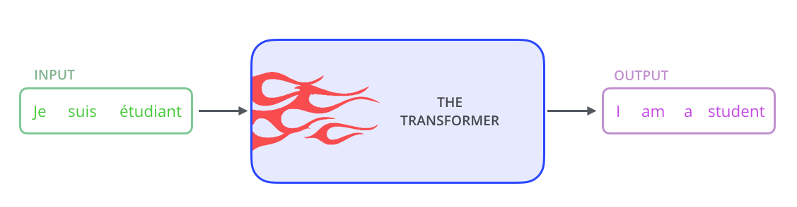

打开这个"擎天柱"（Optimus Prime）的外壳，我们能看到一个编码组件、一个解码组件，以及二者之间的连接。

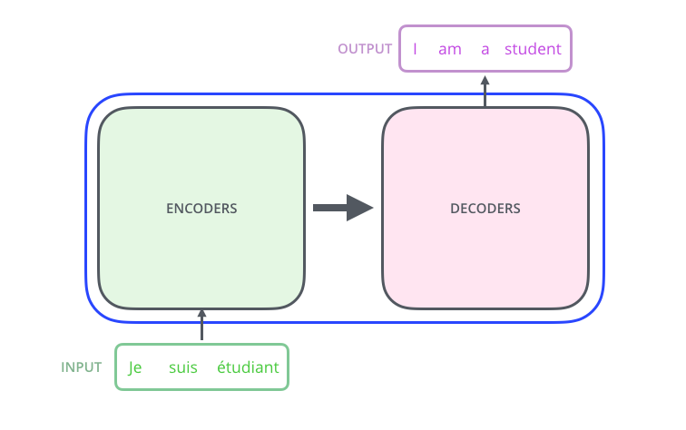

编码组件由一摞编码器（encoder）堆叠而成（论文中堆叠了六个——六这个数字并没有什么神奇之处，你完全可以尝试其他配置）。解码组件则是由相同数量的解码器（decoder）堆叠而成。

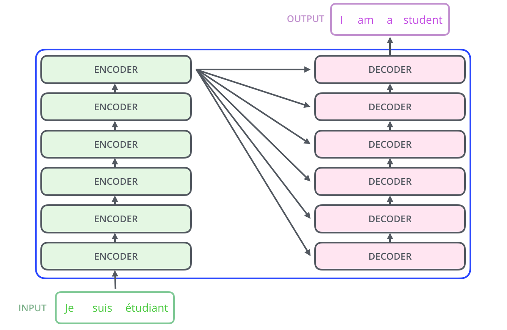

所有编码器的结构完全相同（但它们之间不共享权重）。每个编码器又可以拆分为两个子层：

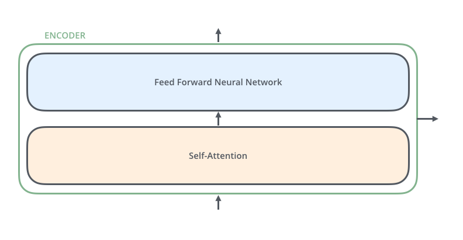

编码器的输入首先流经一个自注意力（self-attention）层——这一层帮助编码器在编码某个特定单词时，能够关注输入句子中的其他单词。我们将在本文后面详细介绍自注意力。

自注意力层的输出会被送入一个前馈神经网络（feed-forward neural network）。完全相同的前馈网络会独立地作用于每个位置。

解码器同样拥有这两层，但在两者之间还有一个注意力层，帮助解码器聚焦于输入句子中的相关部分（类似于 [seq2seq 模型](https://jalammar.github.io/visualizing-neural-machine-translation-mechanics-of-seq2seq-models-with-attention/)中注意力的作用）。

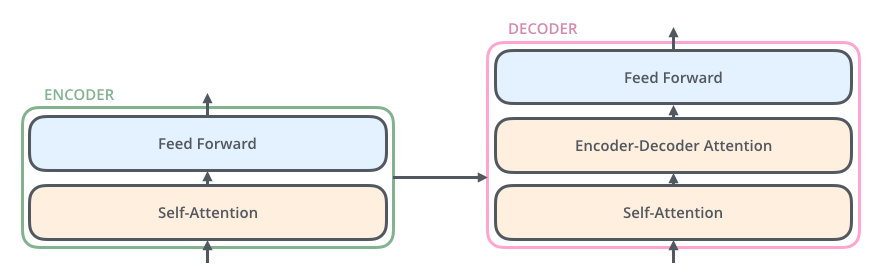

> **译注**：MiniMind 和 GPT、LLaMA 一样是**仅解码器（decoder-only）**架构：没有编码器，也就没有中间的"编码器-解码器注意力"层，每个 block 只有"自注意力 + 前馈网络"两个子层（见 `model/model_minimind.py` 中的 `MiniMindBlock`）。

## 引入张量

现在我们已经了解了模型的主要组件，接下来看看各种向量/张量是如何在这些组件之间流动，从而把一个训练好的模型的输入转化为输出的。

和一般的 NLP 应用一样，我们首先使用[词嵌入算法](https://medium.com/deeper-learning/glossary-of-deep-learning-word-embedding-f90c3cec34ca)把每个输入单词转换为一个向量。

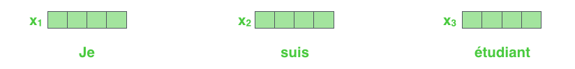

*每个单词都被嵌入为一个大小为 512 的向量。我们用这些简单的方块来表示这些向量。*

词嵌入只发生在最底层的编码器中。所有编码器共有的抽象是：它们接收一个向量列表，列表中每个向量的大小都是 512——在最底层的编码器中，这就是词嵌入；而在其他编码器中，则是其正下方那个编码器的输出。这个列表的长度是一个可以设置的超参数——基本上就是训练数据集中最长句子的长度。

在对输入序列中的单词完成嵌入之后，每个单词都会依次流经编码器的两个层。

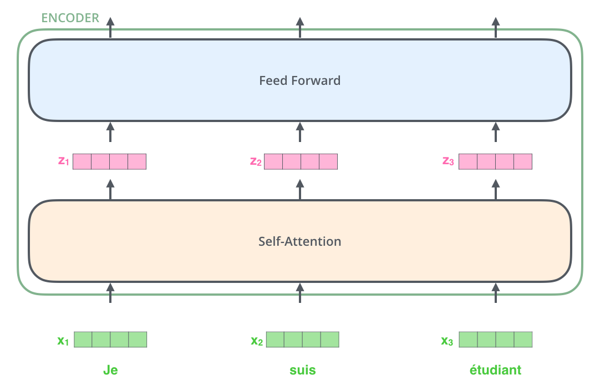

这里我们开始看到 Transformer 的一个关键特性：每个位置上的单词在编码器中沿着各自的路径流动。在自注意力层中，这些路径之间存在依赖关系；而前馈层中则不存在这种依赖，因此各条路径在流经前馈层时可以并行执行。

接下来，我们会换一个更短的句子作为例子，看看编码器的每个子层中都发生了什么。

## 开始编码！

如前所述，编码器接收一个向量列表作为输入。它把这些向量送入"自注意力"层进行处理，再送入前馈神经网络，然后将输出向上传给下一个编码器。

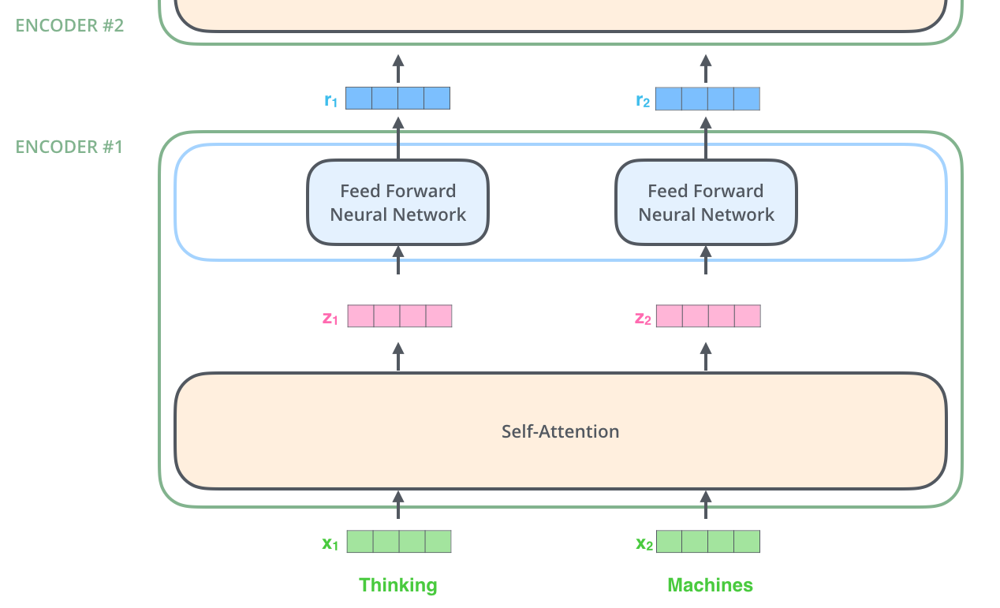

*每个位置上的单词都会经过一个自注意力过程。然后，它们各自经过一个前馈神经网络——是完全相同的网络，每个向量分别独立地流过它。*

## 自注意力概览

别被我随口抛出的"自注意力"这个词唬住，好像它是一个人人都该熟悉的概念。我本人在读到 Attention is All You Need 这篇论文之前，也从未接触过这个概念。下面我们来提炼一下它的工作原理。

假设下面这句话是我们想要翻译的输入句子：

"`The animal didn't cross the street because it was too tired`"
（这只动物没有过马路，因为它太累了）

这个句子中的 "it" 指的是什么？是指 street（街道）还是 animal（动物）？这对人来说是个简单的问题，但对算法来说就没那么简单了。

当模型处理单词 "it" 时，自注意力使它能够将 "it" 与 "animal" 关联起来。

当模型处理每个单词（输入序列中的每个位置）时，自注意力使它能够查看输入序列中的其他位置，寻找有助于更好地编码这个单词的线索。

如果你熟悉 RNN，可以想想维护隐藏状态是如何让 RNN 把它对之前已处理过的单词/向量的表示，与当前正在处理的单词结合起来的。自注意力就是 Transformer 用来把对其他相关单词的"理解"融入当前正在处理的单词中的方法。

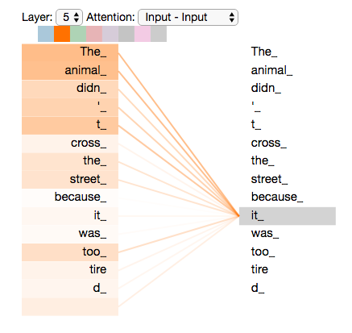

*当我们在 5 号编码器（栈中最顶层的编码器）中编码单词 "it" 时，注意力机制的一部分聚焦在了 "The Animal" 上，并将其表示的一部分融入了 "it" 的编码中。*

请务必看看 [Tensor2Tensor notebook](https://colab.research.google.com/github/tensorflow/tensor2tensor/blob/master/tensor2tensor/notebooks/hello_t2t.ipynb)，你可以在其中加载一个 Transformer 模型，并通过这个交互式可视化工具来考察它。

## 自注意力详解

我们先来看看如何用向量计算自注意力，然后再看它实际上是如何实现的——使用矩阵。

计算自注意力的**第一步**，是根据编码器的每个输入向量（在本例中即每个单词的嵌入）创建三个向量。也就是说，对于每个单词，我们创建一个查询向量（Query）、一个键向量（Key）和一个值向量（Value）。这些向量是通过将嵌入向量与我们在训练过程中训练得到的三个矩阵相乘而得到的。

注意，这些新向量的维度比嵌入向量小。它们的维度是 64，而嵌入向量以及编码器输入/输出向量的维度是 512。它们并非**必须**更小，这是一种架构上的选择，目的是让多头注意力的计算量（大体上）保持不变。

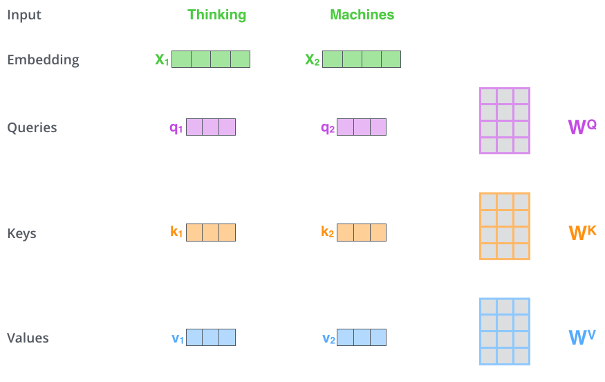

*将 x1 与权重矩阵 WQ 相乘得到 q1，即与该单词相关联的"查询"向量。最终，我们为输入句子中的每个单词都创建了"查询"、"键"和"值"三个投影。*

"查询"、"键"和"值"向量到底是什么？

它们是一种抽象，对于计算和思考注意力很有帮助。继续阅读下文中注意力的计算方式，你就会基本了解这些向量各自扮演的角色。

计算自注意力的**第二步**是计算一个分数（score）。假设我们正在计算本例中第一个单词 "Thinking" 的自注意力。我们需要用输入句子中的每个单词对这个单词进行打分。这个分数决定了在编码某个位置上的单词时，应该对输入句子的其他部分投入多少关注。

分数是通过将**查询向量**与被打分单词的**键向量**做点积来计算的。因此，如果我们正在处理位置 **#1** 上单词的自注意力，那么第一个分数就是 q1 与 k1 的点积，第二个分数是 q1 与 k2 的点积。

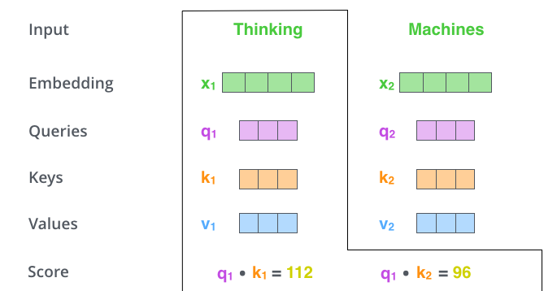

**第三步和第四步**是将分数除以 8（即论文中所用键向量维度 64 的平方根。这样可以得到更稳定的梯度。这里也可以取其他值，但这是默认做法），然后将结果送入 softmax 运算。softmax 会对分数进行归一化，使它们全部为正且总和为 1。

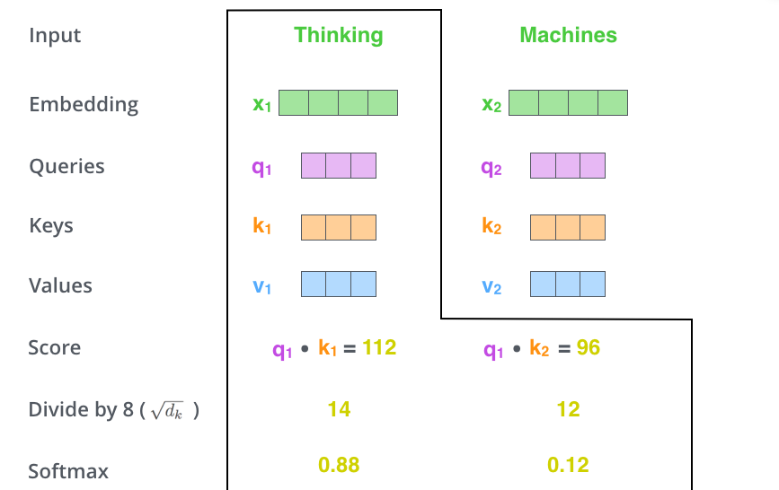

这个 softmax 分数决定了每个单词在当前位置上的表达程度。显然，当前位置上的单词本身会获得最高的 softmax 分数，但有时关注与当前单词相关的另一个单词也是很有用的。

**第五步**是将每个值向量乘以对应的 softmax 分数（为接下来的求和做准备）。这里的直觉是：保持我们想要关注的单词的值不变，同时淹没不相关的单词（例如乘以 0.001 这样很小的数）。

**第六步**是对加权后的值向量求和。这就得到了自注意力层在该位置（对于第一个单词）上的输出。

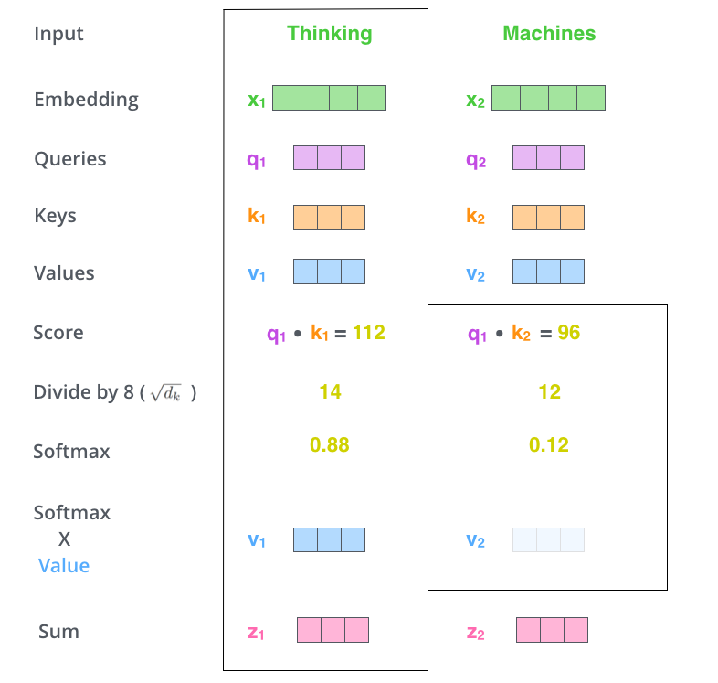

至此，自注意力的计算就完成了。得到的向量可以接着送入前馈神经网络。不过在实际实现中，为了加快处理速度，这一计算是以矩阵形式完成的。既然我们已经在单词层面上理解了计算的直觉，下面就来看看矩阵形式。

## 自注意力的矩阵计算

**第一步**是计算查询矩阵、键矩阵和值矩阵。我们把嵌入向量打包成一个矩阵 X，然后将其与训练得到的权重矩阵（WQ、WK、WV）相乘。

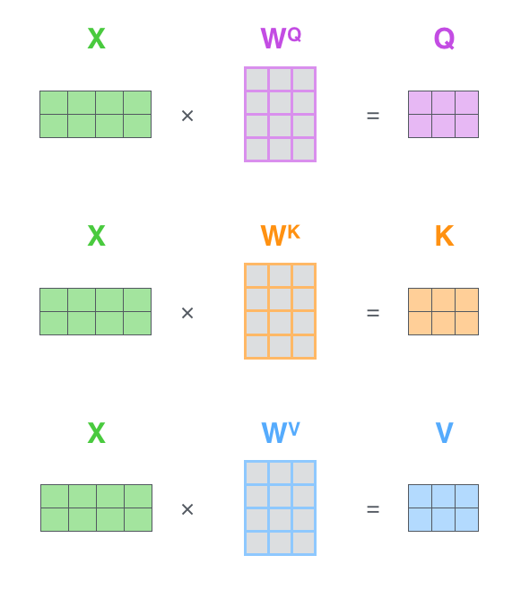

*X 矩阵的每一行对应输入句子中的一个单词。我们再次看到嵌入向量（512 维，图中用 4 个方块表示）与 q/k/v 向量（64 维，图中用 3 个方块表示）在大小上的差异。*

**最后**，由于我们处理的是矩阵，可以把第二步到第六步浓缩成一个公式，来计算自注意力层的输出。

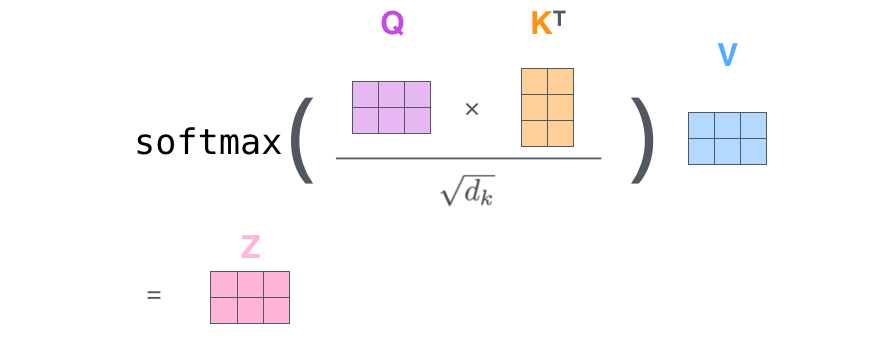

*矩阵形式的自注意力计算*

> **译注**：即 $\text{Attention}(Q,K,V)=\text{softmax}\left(\frac{QK^\top}{\sqrt{d_k}}\right)V$。在 PyTorch 2.x 中可直接调用 `F.scaled_dot_product_attention`，它会自动使用 FlashAttention 等高效实现。

## 多头怪兽

论文通过加入一种称为"多头"（multi-headed）注意力的机制，进一步完善了自注意力层。这从两个方面提升了注意力层的性能：

1. 它扩展了模型关注不同位置的能力。没错，在上面的例子中，z1 包含了一点其他所有单词的编码信息，但它可能被单词本身所主导。如果我们翻译的句子是 "The animal didn't cross the street because it was too tired"，那么知道 "it" 指的是哪个单词会很有用。

2. 它为注意力层提供了多个"表示子空间"（representation subspaces）。我们接下来会看到，在多头注意力中，我们不只有一组、而是有多组查询/键/值权重矩阵（Transformer 使用八个注意力头，因此每个编码器/解码器最终有八组）。每一组都是随机初始化的。训练完成后，每一组都被用来将输入嵌入（或来自下层编码器/解码器的向量）投影到一个不同的表示子空间中。

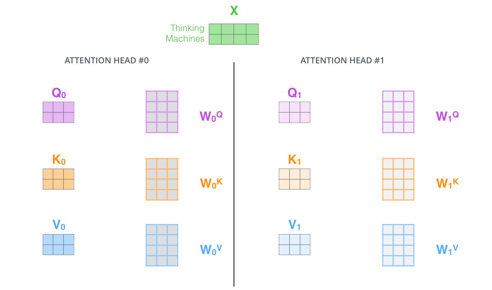

*在多头注意力中，我们为每个头维护独立的 Q/K/V 权重矩阵，从而得到不同的 Q/K/V 矩阵。和之前一样，我们将 X 与 WQ/WK/WV 矩阵相乘，得到 Q/K/V 矩阵。*

如果我们用八组不同的权重矩阵，把上面介绍的自注意力计算做八次，就会得到八个不同的 Z 矩阵。

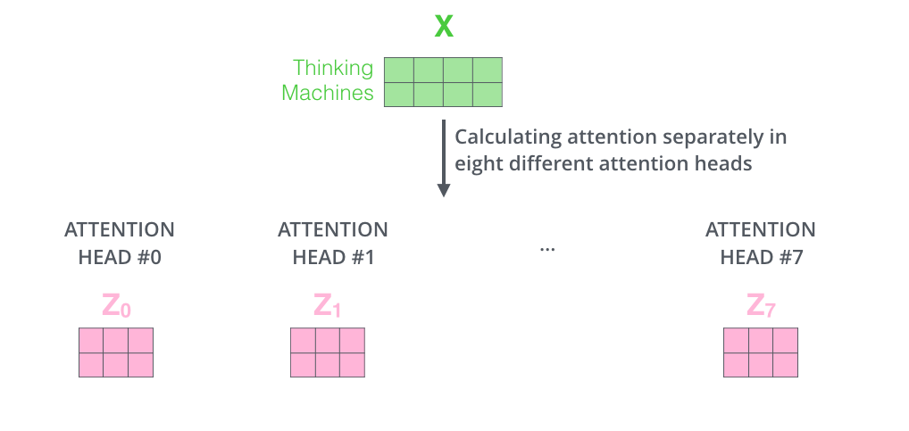

这给我们带来了一个小难题。前馈层期望的不是八个矩阵，而是一个单独的矩阵（每个单词对应一个向量）。因此，我们需要一种方法把这八个矩阵压缩成一个矩阵。

怎么做呢？我们将这些矩阵拼接（concat）起来，然后乘以一个额外的权重矩阵 WO。

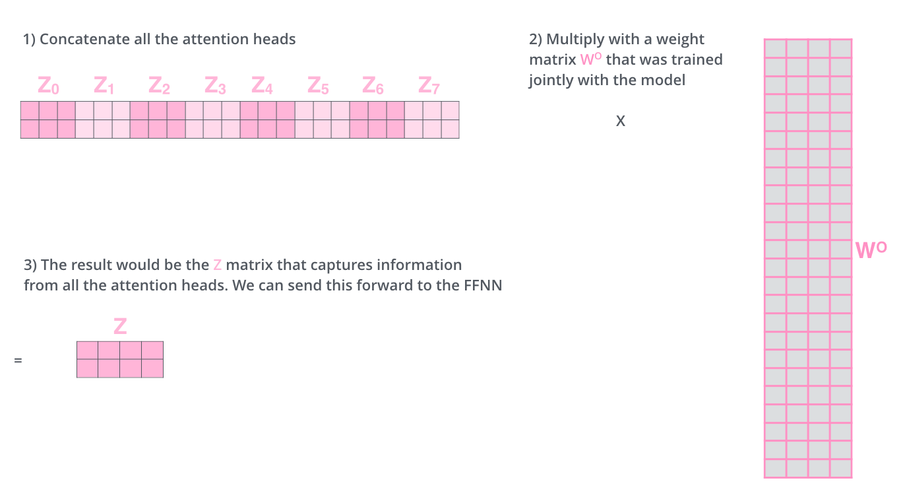

多头自注意力的内容基本就是这些了。我承认，这涉及相当多的矩阵。让我试着把它们都放进一张图里，这样就可以在一个地方统一查看了。

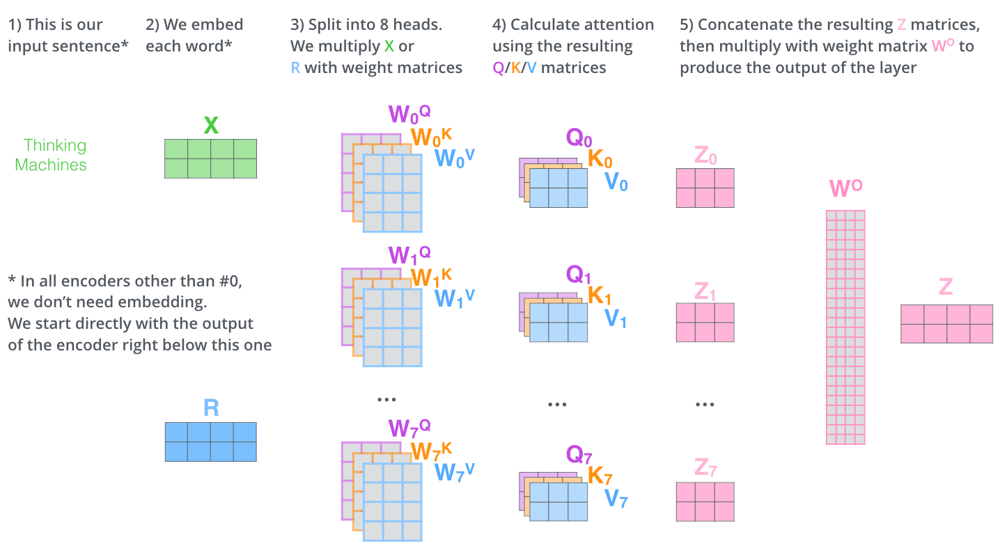

既然已经介绍了注意力头，让我们回到之前的例子，看看在编码例句中的单词 "it" 时，不同的注意力头都在关注哪里：

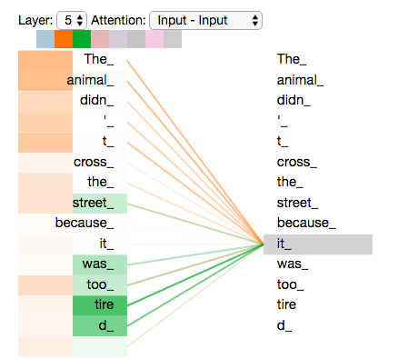

*在编码单词 "it" 时，一个注意力头最关注 "the animal"，而另一个则关注 "tired"——从某种意义上说，模型对单词 "it" 的表示融合了 "animal" 和 "tired" 两者的部分表示。*

然而，如果把所有注意力头都加到图中，结果就更难解释了：

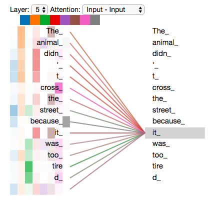

> **译注**：MiniMind 使用的是**分组查询注意力（GQA）**——多个查询头共享同一组 K/V 头（配置中的 `num_attention_heads` 与 `num_key_value_heads`），以减小推理时 KV Cache 的显存占用。这正是本文开头"更新"中提到的 Multi-Query Attention 的推广形式。

## 用位置编码表示序列顺序

到目前为止，我们所描述的模型还缺少一样东西：一种体现输入序列中单词顺序的方法。

为了解决这个问题，Transformer 给每个输入嵌入加上了一个向量。这些向量遵循模型学习到的特定模式，帮助模型确定每个单词的位置，或者序列中不同单词之间的距离。这里的直觉是：将这些值加到嵌入向量上后，一旦嵌入向量被投影为 Q/K/V 向量并参与点积注意力计算，它们之间就会具有有意义的距离。

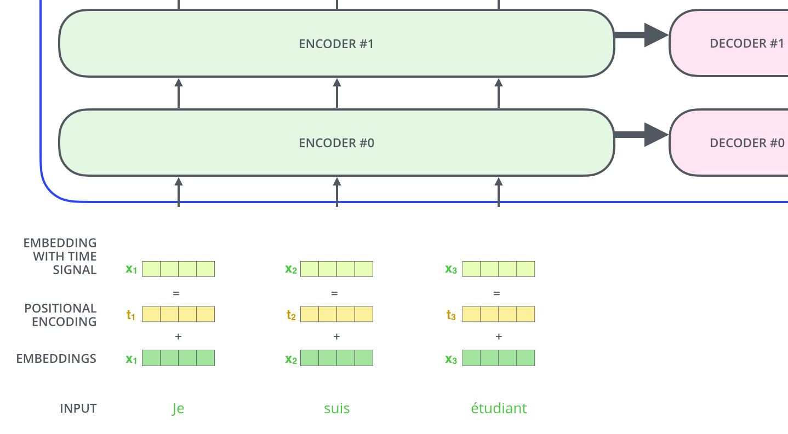

*为了让模型感知单词的顺序，我们加上了位置编码向量——它们的值遵循特定的模式。*

假设嵌入的维度是 4，那么实际的位置编码看起来是这样的：

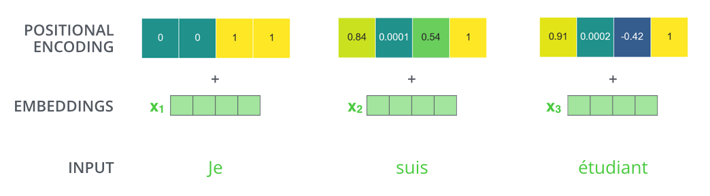

*一个嵌入维度为 4 的玩具示例中，位置编码的真实样子*

这个模式可能是什么样子的呢？

在下图中，每一行对应一个位置编码向量。因此第一行就是我们要加到输入序列中第一个单词嵌入上的向量。每行包含 512 个值——每个值都介于 1 和 -1 之间。我们用颜色对它们进行了编码，以便看出其中的模式。

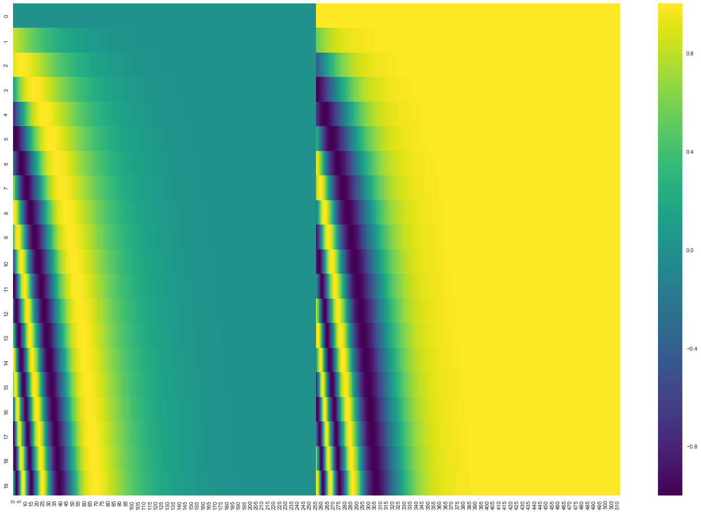

*一个真实的位置编码示例：20 个单词（行），嵌入维度为 512（列）。你可以看到它似乎从中间一分为二。这是因为左半部分的值由一个函数（使用正弦 sine）生成，而右半部分由另一个函数（使用余弦 cosine）生成。然后将二者拼接起来，形成每个位置编码向量。*

位置编码的公式在论文中有描述（第 3.5 节）。你可以在 [`get_timing_signal_1d()`](https://github.com/tensorflow/tensor2tensor/blob/23bd23b9830059fbc349381b70d9429b5c40a139/tensor2tensor/layers/common_attention.py) 中查看生成位置编码的代码。这并不是唯一可行的位置编码方法。不过，它的优势在于能够扩展到训练中未见过的序列长度（例如，当我们训练好的模型被要求翻译一个比训练集中任何句子都长的句子时）。

**2020 年 7 月更新**：上面展示的位置编码来自 Transformer 的 Tensor2Tensor 实现。论文中给出的方法略有不同：它不是直接拼接两种信号，而是将它们交错排列。下图展示了这种方式的效果。[这里是生成该图的代码](https://github.com/jalammar/jalammar.github.io/blob/master/notebookes/transformer/transformer_positional_encoding_graph.ipynb)：

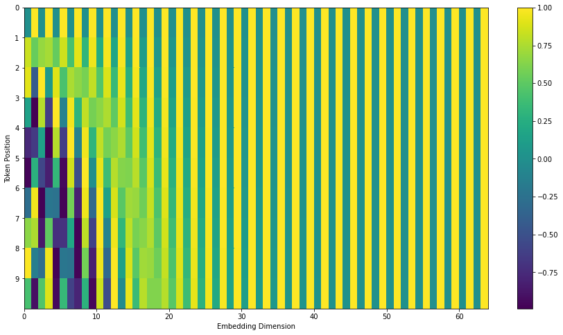

> **译注**：原始 Transformer 是把位置编码**加到输入嵌入上**的绝对位置编码。MiniMind 使用的是 **RoPE（旋转位置编码）**：不修改嵌入，而是在每一层注意力中对 Q、K 按位置做旋转，使 $q_m \cdot k_n$ 只依赖相对位置 $m-n$；并通过 YaRN 对频率做缩放以支持长度外推（见 `precompute_freqs_cis`）。

## 残差连接

在继续之前，编码器架构中还有一个细节需要提一下：每个编码器中的每个子层（自注意力、前馈网络）周围都有一个残差连接（residual connection），并且之后紧跟一个[层归一化](https://arxiv.org/abs/1607.06450)（layer-normalization）步骤。

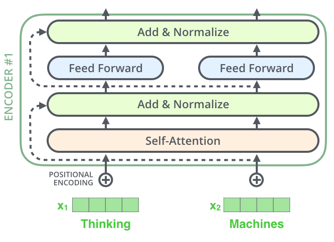

如果把与自注意力相关的向量和层归一化操作可视化出来，看起来是这样的：

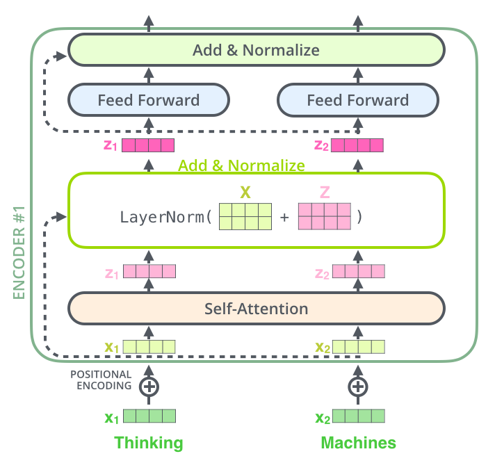

解码器的子层也是如此。如果我们设想一个由 2 个编码器和 2 个解码器堆叠而成的 Transformer，它看起来大致如下：

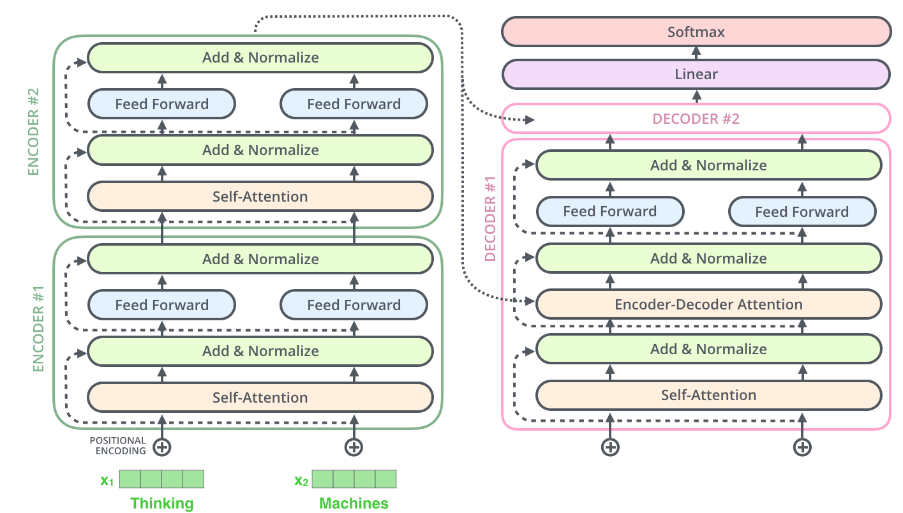

> **译注**：图中是原始论文的 **Post-LN** 结构——先做残差相加，再做 LayerNorm：$x_{l+1}=\text{LN}(x_l+F(x_l))$。MiniMind 与现代 LLM 采用的是 **Pre-LN**：$x_{l+1}=x_l+F(\text{Norm}(x_l))$，并用 **RMSNorm** 代替 LayerNorm。Pre-LN 让残差主干保持恒等映射、梯度更稳定，因此训练时可以不用 warmup。本仓库 `experiments/exp1_gradient_vanishing.py` 对比了有无归一化时梯度的变化。

## 解码器端

我们已经介绍了编码器端的大部分概念，因此基本上也就知道了解码器各组件的工作原理。下面来看看它们是如何协同工作的。

编码器首先处理输入序列。最顶层编码器的输出随后被转换为一组注意力向量 K 和 V。每个解码器都会在其"编码器-解码器注意力"（encoder-decoder attention）层中使用它们，这帮助解码器聚焦于输入序列中的适当位置：

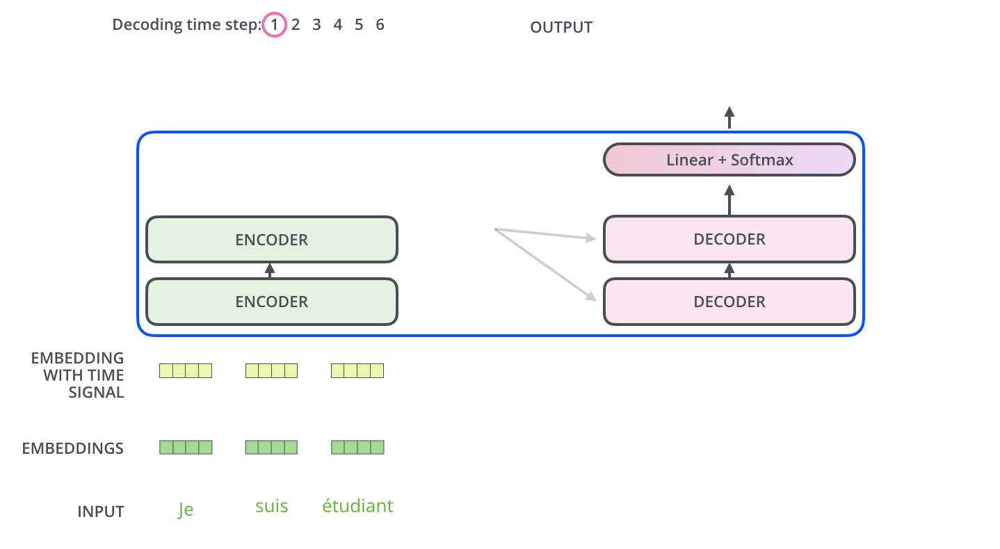

*编码阶段完成后，我们开始解码阶段。解码阶段的每一步都会输出输出序列中的一个元素（在本例中是英文译文句子）。*

接下来的步骤会重复这个过程，直到出现一个特殊的 <句子结束> 符号，表示 Transformer 解码器已经完成了输出。每一步的输出都会在下一个时间步被送入最底层的解码器，解码器像编码器那样把解码结果逐层向上传递。并且，就像我们对编码器输入所做的那样，我们也会对这些解码器输入进行嵌入并加上位置编码，以表示每个单词的位置。

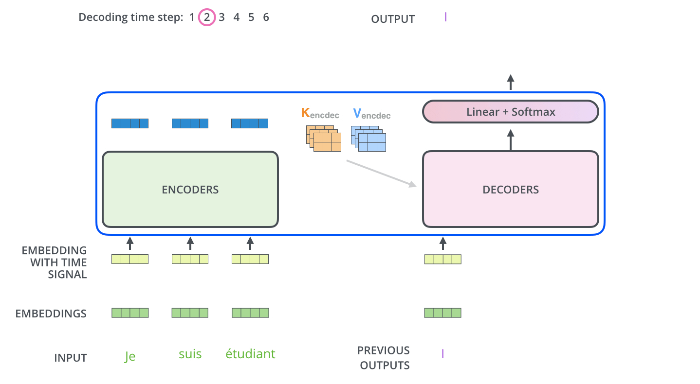

解码器中的自注意力层与编码器中的工作方式略有不同：

在解码器中，自注意力层只允许关注输出序列中更早的位置。这是通过在自注意力计算的 softmax 步骤之前，屏蔽（mask）未来的位置（将它们设为 `-inf`）来实现的。

"编码器-解码器注意力"层的工作方式与多头自注意力完全相同，区别只在于：它从其下方的层创建查询矩阵（Queries），而从编码器栈的输出中获取键矩阵（Keys）和值矩阵（Values）。

> **译注**：这里说的"屏蔽未来位置"就是**因果掩码（causal mask）**，也是 decoder-only 语言模型（包括 MiniMind）中唯一的注意力形式。推理时每生成一个 token，之前各位置的 K、V 都不会改变，因此可以缓存下来复用，这就是 **KV Cache**（`past_key_value`）。

## 最后的线性层与 Softmax 层

解码器栈输出的是一个浮点数向量。我们如何把它变成一个单词？这就是最后的线性层（Linear）及其后的 Softmax 层的工作。

线性层是一个简单的全连接神经网络，它把解码器栈产生的向量投影到一个大得多的向量上，这个向量称为 logits 向量。

假设我们的模型知道 10,000 个不同的英文单词（即模型的"输出词表"），这些单词是从训练数据集中学到的。那么 logits 向量就有 10,000 个单元格宽——每个单元格对应一个单词的分数。这就是我们对模型经过线性层后的输出的解释。

然后 softmax 层把这些分数转换为概率（全部为正，总和为 1.0）。选择概率最高的单元格，与之对应的单词就作为这个时间步的输出。

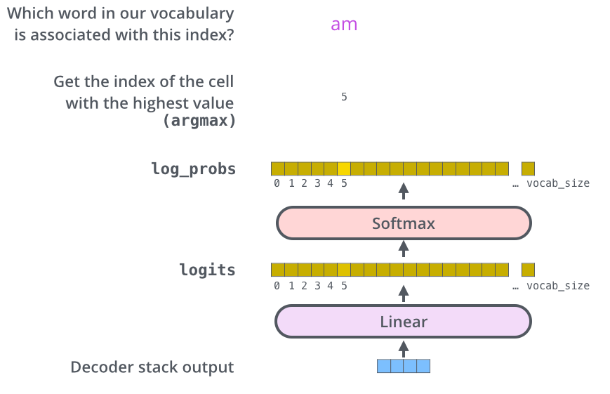

*这张图从底部开始，是解码器栈输出的向量。随后它被转换为一个输出单词。*

## 训练回顾

既然我们已经介绍了一个训练好的 Transformer 的完整前向传播过程，那么简单了解一下训练模型的直觉会很有帮助。

在训练过程中，一个未经训练的模型会经历完全相同的前向传播。但由于我们是在一个带标签的训练数据集上训练它，因此可以将它的输出与真正正确的输出进行比较。

为了直观展示，假设我们的输出词表只包含六个单词（"a"、"am"、"i"、"thanks"、"student" 和 "&lt;eos&gt;"（end of sentence，即"句子结束"的缩写））。

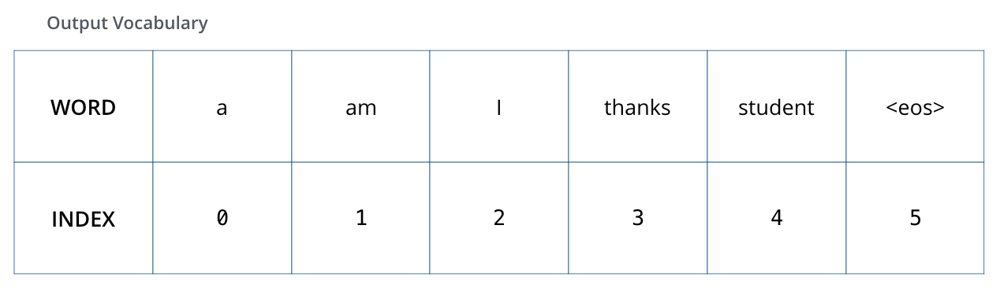

*我们模型的输出词表是在开始训练之前的预处理阶段创建的。*

一旦定义好输出词表，我们就可以用一个同样宽度的向量来表示词表中的每个单词。这也称为独热编码（one-hot encoding）。例如，我们可以用下面这个向量来表示单词 "am"：

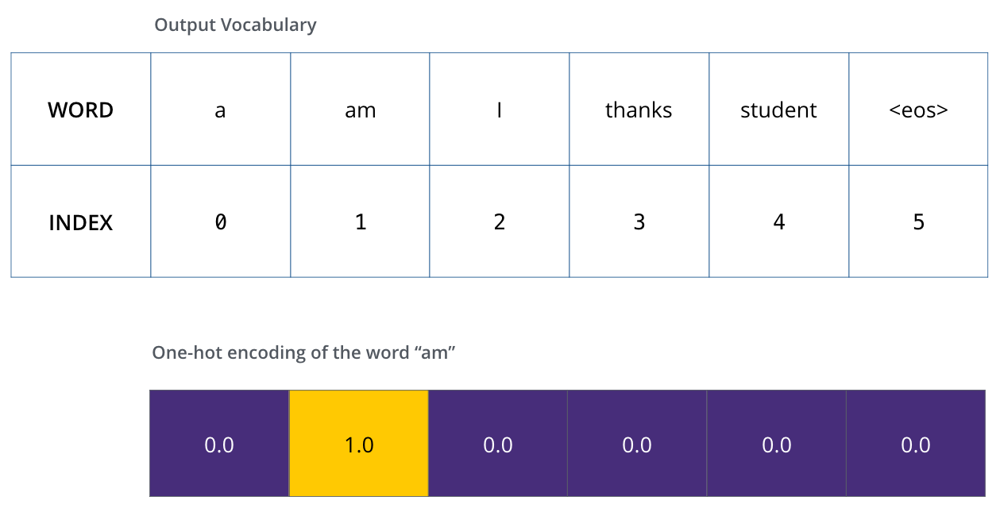

*示例：对输出词表的独热编码*

回顾完这些之后，我们来讨论模型的损失函数——即我们在训练阶段要优化的指标，它将引导我们得到一个训练好的、并且希望是极其准确的模型。

## 损失函数

假设我们正在训练模型，并且这是训练阶段的第一步，我们用一个简单的例子来训练它——把 "merci" 翻译成 "thanks"。

这意味着，我们希望输出是一个指示单词 "thanks" 的概率分布。但由于这个模型还没有经过训练，目前这还不太可能实现。

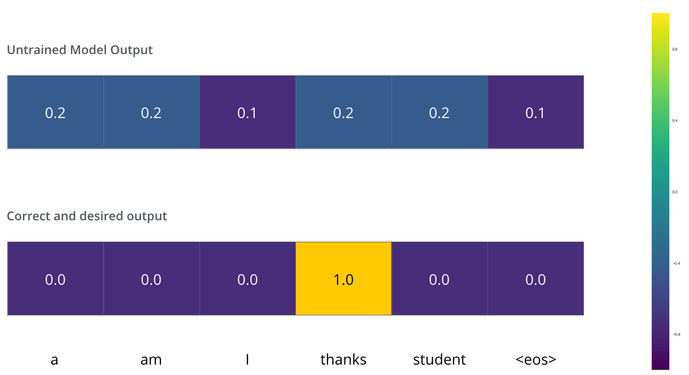

*由于模型的参数（权重）都是随机初始化的，（未训练的）模型会为每个单元格/单词产生一个取值任意的概率分布。我们可以将它与实际输出进行比较，然后利用反向传播调整模型的所有权重，使输出更接近期望的输出。*

如何比较两个概率分布？我们只需用一个减去另一个即可。更多细节可以参考[交叉熵（cross-entropy）](https://colah.github.io/posts/2015-09-Visual-Information/)和 [KL 散度（Kullback–Leibler divergence）](https://www.countbayesie.com/blog/2017/5/9/kullback-leibler-divergence-explained)。

但请注意，这是一个过度简化的例子。更现实的情况是，我们会使用多于一个单词的句子。例如——输入："je suis étudiant"，期望输出："i am a student"。这实际上意味着，我们希望模型能依次输出这样的概率分布：

- 每个概率分布都由一个宽度为 vocab_size 的向量表示（在我们的玩具示例中是 6，但更实际的数字是 30,000 或 50,000）
- 第一个概率分布在单词 "i" 对应的单元格上概率最高
- 第二个概率分布在单词 "am" 对应的单元格上概率最高
- 依此类推，直到第五个输出分布指向 '`<end of sentence>`' 符号，该符号在 10,000 个元素的词表中同样有一个与之对应的单元格。

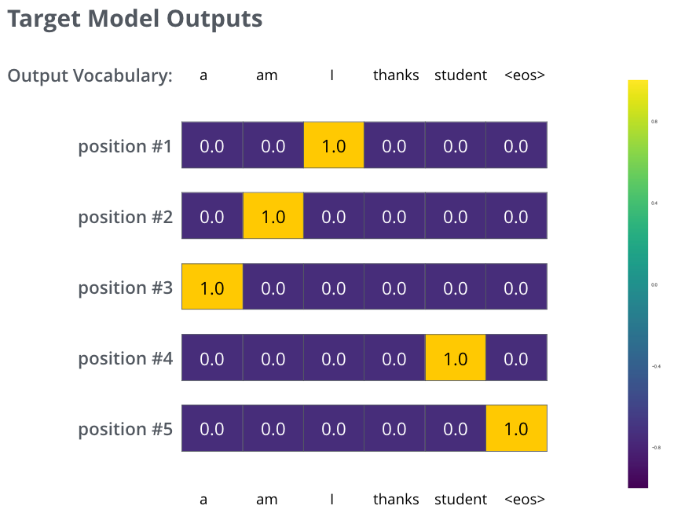

*在一个例句的训练样本中，我们训练模型所要拟合的目标概率分布。*

在足够大的数据集上训练模型足够长的时间后，我们希望产生的概率分布看起来像这样：

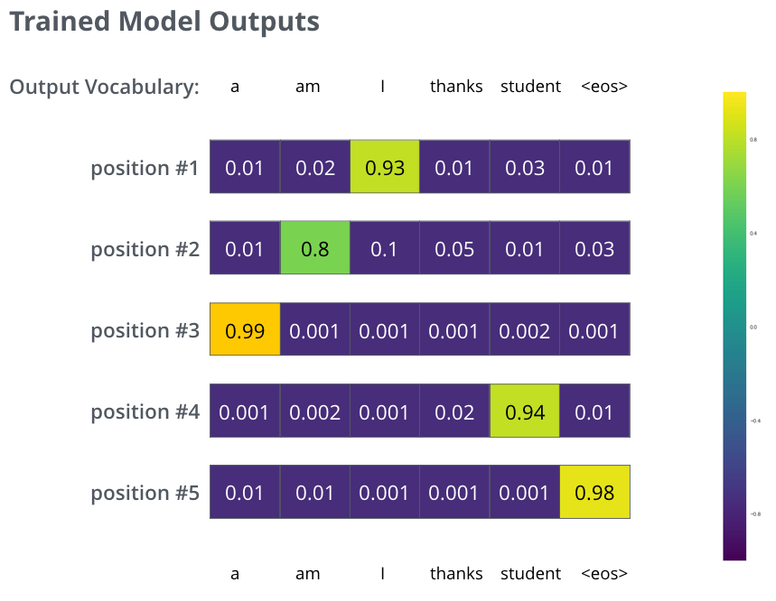

*希望在训练之后，模型能输出我们期望的正确译文。当然，如果这个短语本身就是训练数据集的一部分，那这并不能真正说明什么（参见：[交叉验证](https://www.youtube.com/watch?v=TIgfjmp-4BA)）。注意，即使某个位置不太可能是该时间步的输出，它也会获得一点概率——这是 softmax 一个非常有用的特性，有助于训练过程。*

现在，由于模型一次输出一个结果，我们可以假设模型从概率分布中选取概率最高的单词，并丢弃其余的单词。这是一种做法（称为贪心解码，greedy decoding）。另一种做法是保留概率最高的两个单词（比如 'I' 和 'a'），然后在下一步中运行模型两次：一次假设第一个输出位置是单词 'I'，另一次假设第一个输出位置是单词 'a'，综合考虑位置 #1 和 #2，保留误差更小的那个版本。我们对位置 #2 和 #3 等重复这一过程。这种方法称为"束搜索"（beam search）。在我们的例子中，beam_size 为 2（意味着在任何时候，内存中都保留两个部分假设，即未完成的译文），top_beams 也为 2（意味着我们将返回两个译文）。这两个都是可以实验调整的超参数。

> **译注**：MiniMind 预训练时的损失就是对下一个 token 的交叉熵；推理时（`eval_llm.py`）通常用 temperature + top-p 采样，而不是贪心解码或束搜索。

## 去 Transform 吧

我希望这篇文章能成为你打破坚冰、了解 Transformer 主要概念的一个有用起点。如果你想更深入地学习，我建议接下来：

- 阅读论文 [Attention Is All You Need](https://arxiv.org/abs/1706.03762)、Transformer 博客文章（[Transformer: A Novel Neural Network Architecture for Language Understanding](https://ai.googleblog.com/2017/08/transformer-novel-neural-network.html)），以及 [Tensor2Tensor 发布公告](https://ai.googleblog.com/2017/06/accelerating-deep-learning-research.html)。
- 观看 [Łukasz Kaiser 的演讲](https://www.youtube.com/watch?v=rBCqOTEfxvg)，他详细讲解了这个模型及其细节
- 动手试试 [Tensor2Tensor 仓库中提供的 Jupyter Notebook](https://colab.research.google.com/github/tensorflow/tensor2tensor/blob/master/tensor2tensor/notebooks/hello_t2t.ipynb)
- 探索 [Tensor2Tensor 仓库](https://github.com/tensorflow/tensor2tensor)。

后续工作：

- [Depthwise Separable Convolutions for Neural Machine Translation](https://arxiv.org/abs/1706.03059)
- [One Model To Learn Them All](https://arxiv.org/abs/1706.05137)
- [Discrete Autoencoders for Sequence Models](https://arxiv.org/abs/1801.09797)
- [Generating Wikipedia by Summarizing Long Sequences](https://arxiv.org/abs/1801.10198)
- [Image Transformer](https://arxiv.org/abs/1802.05751)
- [Training Tips for the Transformer Model](https://arxiv.org/abs/1804.00247)
- [Self-Attention with Relative Position Representations](https://arxiv.org/abs/1803.02155)
- [Fast Decoding in Sequence Models using Discrete Latent Variables](https://arxiv.org/abs/1803.03382)
- [Adafactor: Adaptive Learning Rates with Sublinear Memory Cost](https://arxiv.org/abs/1804.04235)

## 致谢

感谢 [Illia Polosukhin](https://twitter.com/ilblackdragon)、[Jakob Uszkoreit](http://jakob.uszkoreit.net/)、[Llion Jones](https://www.linkedin.com/in/llion-jones-9ab3064b)、[Lukasz Kaiser](https://ai.google/research/people/LukaszKaiser)、[Niki Parmar](https://twitter.com/nikiparmar09) 和 [Noam Shazeer](https://dblp.org/pers/hd/s/Shazeer:Noam) 对本文早期版本提供的反馈。

如有任何勘误或反馈，欢迎在 [Twitter](https://twitter.com/JayAlammar) 上联系我。

---

*原文写于 2018 年 6 月 27 日。*
